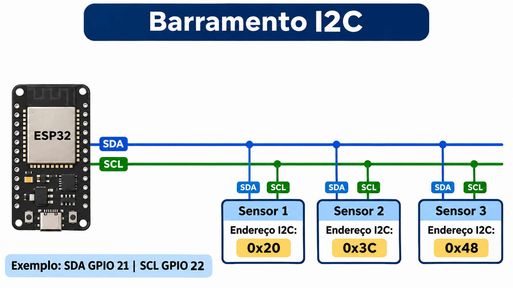
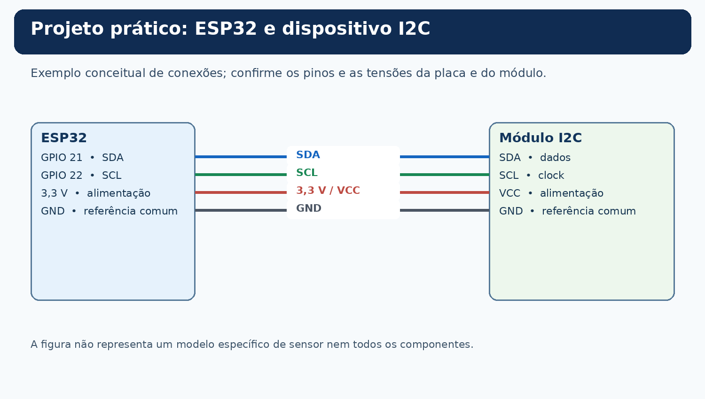
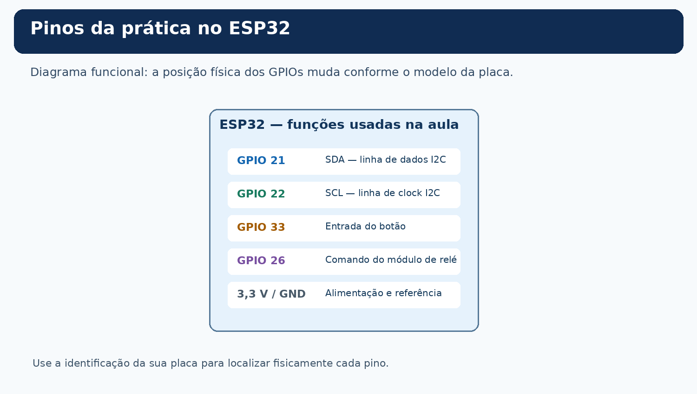
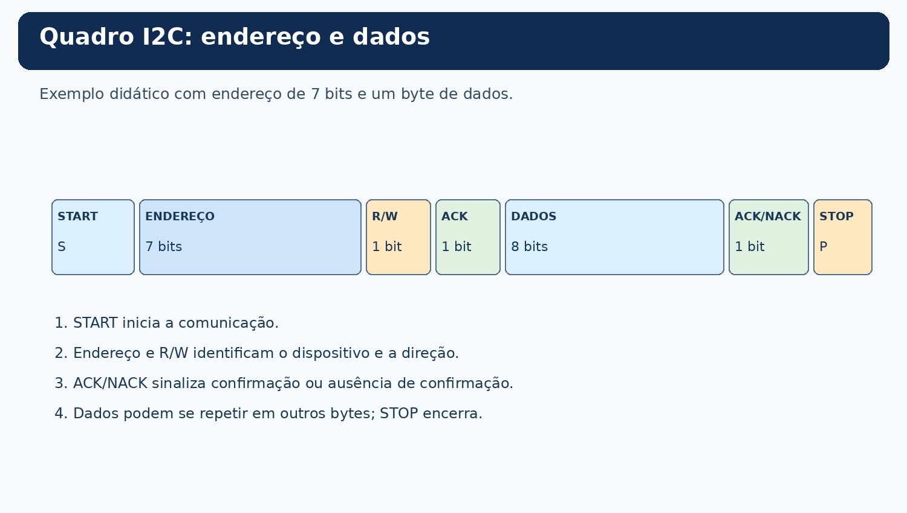
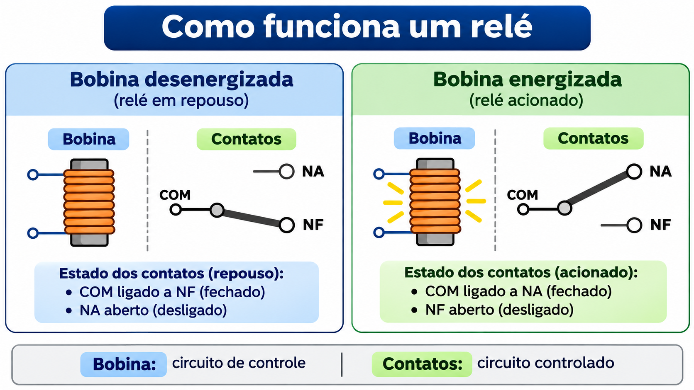
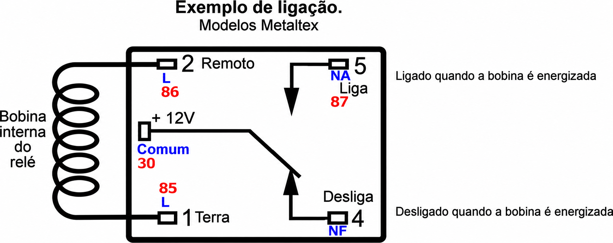
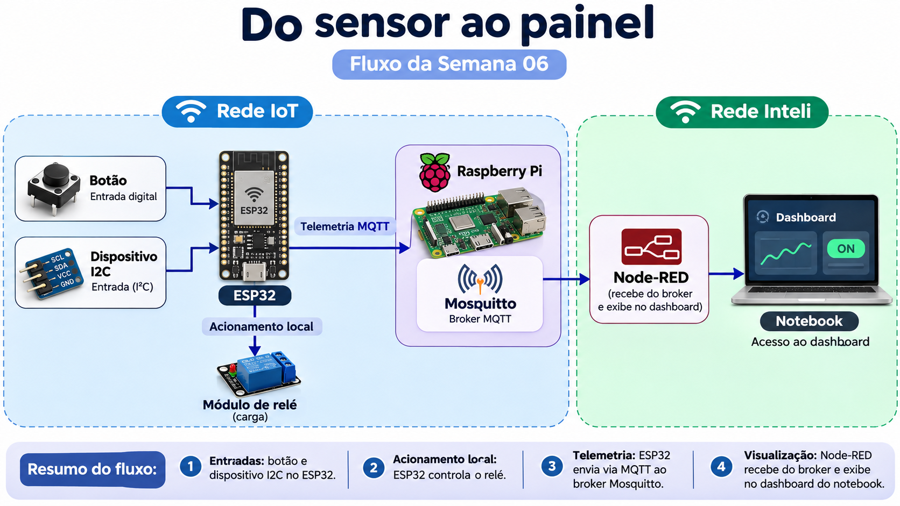

# Semana 06: Sistema de disparo de atuadores

Neste encontro, será apresentado como ativar acionadores básicos (linha de força, motores, relés) a partir da resposta de sensores de forma a implementar regras de atuação. Adicionalmente, trataremos no detalhe, como funciona a comunicação I2C.

## Assuntos relacionados

- Atuadores

- Interfaces de comunicação

- Microcontroladores

- Broker MQTT local Mosquitto e Node-RED

## Perguntas que podem impactar o seu projeto:

### (1) Quantos sensores I2C cabem no ESP32?

### (2) Quais ideias podem melhorar o seu projeto?

### (3) Qual a vantagem de se usar sensores I2C?

### (4) Quais os cuidados se você usar relés no seu projeto?

### (5) Como conectar o acionamento local de um atuador ao monitoramento pelo broker da sala?

https://portal.vidadesilicio.com.br/descobrindo-o-endereco-i2c/


## Protocolo I2C

O barramento I2C (Inter-Integrated Circuit) é um protocolo de comunicação serial que permite a interconexão de vários dispositivos em um mesmo barramento. 

No ESP32, o I2C é implementado por meio de hardware e software. Veja na Fig. 1, como se comporta fisicamente as conexões eletrônica no barramento I2C.




*Os endereços apresentados são exemplos. A imagem destaca as linhas de comunicação; não representa todas as conexões de alimentação.*


Note que o mesmo par de fios SDA e SCL é usado para conectar todos os sensores. Não pode haver inversão desses pinos. Se isso acontecer, toda a comunicação será interrompida. A função de cada pino é a seguinte:

- **SDA (Serial Data Line):** Pino para a linha de dados. Este pino é usado para enviar e receber dados.
- **SCL (Serial Clock Line):** Pino para a linha de clock. Este pino é usado para sincronizar a transferência de dados entre dispositivos.

Na figura a seguir, é possível entender melhor como um projeto prático pode ser montado:



Em muitas placas com ESP32, os pinos padrão são SDA no GPIO 21 e SCL no GPIO 22. Os pinos podem variar conforme a placa e ser configurados por software; confirme o modelo e sua pinagem. Use resistores pull-up adequados nas linhas SDA e SCL e confira se os módulos trabalham com níveis lógicos compatíveis com 3,3 V.




*A figura apresenta funções lógicas, não a posição física dos pinos. Confira a pinagem do modelo de ESP32 utilizado.*


## Quantidade de Dispositivos Suportados

No endereçamento I2C de 7 bits há 128 combinações possíveis (`0x00` a `0x7F`). Parte delas é reservada; a faixa de endereços comuns é `0x08` a `0x77`, com 112 endereços possíveis. Isso **não significa que 112 sensores necessariamente funcionarão no mesmo barramento**: considere endereços fixos ou repetidos, capacitância, pull-ups, alimentação, velocidade e características dos módulos. Alguns dispositivos permitem selecionar endereço por pinos ou jumpers; outros precisam de um multiplexador I2C quando há conflito.

O scanner abaixo procura respostas na faixa comum e mostra o endereço no Monitor Serial. Ele identifica que algum dispositivo respondeu naquele endereço, mas **não identifica o tipo de sensor nem lê seu valor**. Escolha os pinos conforme sua placa e abra o Monitor Serial em 115200 baud.

```cpp
#include <Wire.h>

void setup() {
  Serial.begin(115200);
  Wire.begin(21, 22); // SDA e SCL comuns no ESP32; confirme sua placa.
  Serial.println("Scanner I2C: varrendo enderecos...");
  int encontrados = 0;
  for (uint8_t endereco = 0x08; endereco <= 0x77; endereco++) {
    Wire.beginTransmission(endereco);
    uint8_t resultado = Wire.endTransmission();
    if (resultado == 0) {
      Serial.printf("Dispositivo respondeu em 0x%02X\n", endereco);
      encontrados++;
    }
  }
  Serial.printf("Total de enderecos com resposta: %d\n", encontrados);
}

void loop() {
  // A varredura é realizada uma vez ao iniciar.
}
```

## Comunicação I2C:

A comunicação I2C é iniciada pelo mestre (ESP32) e pode envolver um ou mais dispositivos escravos. A comunicação consiste em transferências de dados em bytes. O mestre envia um endereço de dispositivo seguido por dados ou recebe dados do dispositivo escravo. **Você pode usar endereços na base decimal (0 até 127) ou hexadecimal (0x00 até 0x7F)**.

Uma frequência comum é 100 kHz. A velocidade máxima depende do controlador, dos dispositivos, dos resistores e da capacitância do barramento; não assuma que todos os módulos suportam os modos mais rápidos do I2C.

A vantagem de usar a comunicação I2C é facilidade e simplicidade da pinagem. O código-fonte é relativamente simples para extrair dados dos sensores.

## Cabeçalho do I2C

A figura a seguir mostra como o cabeçalho do I2C é organizado. Em uma transferência com endereço de 7 bits, o primeiro byte de endereçamento combina esses 7 bits com o bit de leitura/escrita. Há pulsos de confirmação ACK/NACK e, conforme a operação, podem ser transferidos um ou mais bytes de dados. O protocolo e os registradores específicos dependem do dispositivo.



## Documentação Oficial I2C

Esse link está a documentação oficial da fabricante do ESP32, chamada Espressif.

[Documentação](https://espressif-docs.readthedocs-hosted.com/projects/arduino-esp32/en/latest/api/i2c.html)

### Configuração do Barramento I2C:

Para usar o I2C no ESP32, é necessário inicializar e configurar o barramento. A biblioteca mais usada para o I2C chama-se **Wire.h**.

```cpp
#include <Wire.h>

void setup() {
  Wire.begin();          // Inicializa o barramento I2C
  Serial.begin(115200);  // Inicializa a comunicação UART, que nesse caso, ocorre pelo cabo USB.
}

void loop() {
  // Seu código aqui
}
```

#### Enviando dados para um dispositivo escravo:

```cpp
#include <Wire.h>

void setup() {
  Wire.begin();
  Serial.begin(115200);
}

void loop() {
  Wire.beginTransmission(8); // 8 é o endereço do dispositivo escravo
  Wire.write(42);            // Dado a ser enviado
  Wire.endTransmission();
  delay(500);
}
```

#### Recebendo dados de um dispositivo escravo:

```cpp
#include <Wire.h>

void setup() {
  Wire.begin();
  Serial.begin(115200);
}

void loop() {
  Wire.requestFrom(8, 6); // Solicita 6 bytes do dispositivo escravo com endereço 8
  while (Wire.available()) {
    char c = Wire.read(); // Lê os dados recebidos
    Serial.print(c);
  }
  delay(500);
}
```

## Ideias de aprimoramento

O aprimoramento vem com a adição de novas informações ao seu projeto. Tente adicionar sensores que lhe tragam mais insights:

- De barreira por infravermelho que conta acessos de pessoas ou registro de pessoas no local

- Piezoelétrico que converte vibração mecânica em sinal elétrico

- De presença por infravermelho que registra pessoas de uma forma mais ampla

- De toque em maçanetas ou portas usando entradas touch nativas do ESP32

 Locais que podem inserir sensores:

- Tapetes
  
- Sola de sapatos

- Roupas

- Batentes de portas

- Acessórios e ardonos

- Relógios

- Capinhas de celular

- Medidor de nível do óleo

- No interruptor da lâmpada do local

- Botão de comando da prensa

## O que é um relé?

Um relé é um dispositivo eletromecânico que utiliza um eletroímã para controlar um ou mais contatos elétricos. Sua principal função é abrir ou fechar circuitos elétricos, permitindo o controle de dispositivos de alta potência por meio de sinais elétricos de baixa potência. 


## Para que serve no seu projeto?

Em um protótipo, um relé pode ser usado para demonstrar o acionamento de uma carga compatível ou de um sinalizador conforme a leitura de sensores. O circuito da aula é demonstrativo: o controle de segurança de máquinas requer projeto e dispositivos de segurança adequados.
O relé pode servir como uma chave liga-desliga que só liga se todos os sensores e o algoritmo **autorizar** o correto funcionamento.

Vamos explorar o funcionamento de um relé em detalhes:

### Componentes de um Relé:

1. **Eletroímã (Bobina):**
   - O eletroímã é formado por uma bobina com várias espiras de fio condutor. Quando uma corrente elétrica passa pela bobina, cria um campo magnético em torno dela.

2. **Contatos (Comutadores):**
   - Os relés têm contatos móveis que podem estar em uma de duas posições: normalmente abertos (NA) ou normalmente fechados (NF). Os contatos normalmente abertos estão abertos quando a bobina não está energizada, e os contatos normalmente fechados estão fechados quando a bobina não está energizada.

3. **Mola de Retorno:**
   - Para garantir a comutação rápida dos contatos, um relé geralmente possui uma mola de retorno que retorna os contatos à sua posição original quando a bobina é desenergizada.

4. **Armatura (Mecanismo de Comutação):**
   - A armatura é uma peça móvel atraída pelo campo magnético gerado pela bobina. A armatura é conectada aos contatos móveis.

### Funcionamento Básico:

1. **Desenergizado (Repouso):**
   - Quando a bobina não está energizada, a armatura é mantida em sua posição original pela mola de retorno. Nessa situação, os contatos podem ser normalmente abertos (NA) ou normalmente fechados (NF) dependendo do tipo de relé.

2. **Energizado:**
   - Quando uma corrente elétrica é aplicada à bobina, ela gera um campo magnético que atrai a armatura. A armatura é puxada para a bobina contra a força da mola de retorno.

3. **Comutação dos Contatos:**
   - A movimentação da armatura causa a comutação dos contatos. Se os contatos estavam normalmente abertos, agora eles se fecham; se estavam normalmente fechados, agora eles se abrem.

4. **Desenergização:**
   - Quando a corrente é removida da bobina, a mola de retorno retorna a armatura à sua posição original. Os contatos retornam à sua condição normal (normalmente abertos ou normalmente fechados).

### Diagrama Esquemático:

Aqui está um diagrama esquemático simplificado para ajudar a visualizar o funcionamento:



1. **Bobina (Circuito de Controle):**
   - O símbolo da bobina representa o circuito de controle que é conectado à fonte de alimentação.

2. **Contatos (Circuito Controlado):**
   - Os contatos NA (normalmente abertos) e NF (normalmente fechados) representam os circuitos controlados pelo relé.

### Exemplo de ligação de um relé

A figura abaixo apresenta um exemplo de ligação de um relé eletromecânico. Observe a bobina à esquerda e os contatos de comutação à direita.



* **Bobina:** quando recebe alimentação adequada, cria o campo magnético que movimenta o mecanismo do relé.
* **Comum (COM):** contato móvel que muda de ligação quando a bobina é energizada.
* **Normalmente fechado (NF):** ligado ao comum quando a bobina está desenergizada; abre quando o relé é acionado.
* **Normalmente aberto (NA):** aberto em repouso; conecta-se ao comum quando o relé é acionado.

A numeração e a tensão indicadas na imagem pertencem ao exemplo ilustrado. Consulte a documentação do relé usado na bancada antes de realizar a montagem; a bobina não deve ser ligada diretamente ao GPIO do ESP32.


## Como energizar um relé?

Um sinal no GPIO pode comandar um **módulo de relé compatível com a saída de 3,3 V do ESP32**, conforme as especificações do módulo. A bobina não deve ser ligada diretamente ao GPIO. Alguns módulos acionam com `LOW` e outros com `HIGH`; consulte o fabricante e verifique também a fonte de alimentação, a corrente e a necessidade de referência comum entre o módulo e o ESP32.

A seguir, um exemplo de acionamento **local** por botão com `INPUT_PULLUP`. Ele considera um módulo ativo em nível baixo: pressionar o botão energiza o relé; ao soltá-lo, o relé é desativado. Use o GPIO 33 para o botão e o GPIO 26 para a entrada do módulo, respeitando a pinagem de sua placa. Não conecte cargas de rede elétrica nesta prática.

```cpp
const int PINO_BOTAO = 33;
const int PINO_RELE = 26;
const int RELE_LIGADO = LOW;     // Confirme a lógica do seu módulo.
const int RELE_DESLIGADO = HIGH;

void setup() {
  pinMode(PINO_BOTAO, INPUT_PULLUP);
  digitalWrite(PINO_RELE, RELE_DESLIGADO);
  pinMode(PINO_RELE, OUTPUT);
  Serial.begin(115200);
}

void loop() {
  bool pressionado = digitalRead(PINO_BOTAO) == LOW;
  digitalWrite(PINO_RELE, pressionado ? RELE_LIGADO : RELE_DESLIGADO);
}
```

Com `INPUT_PULLUP`, ligue o botão entre o GPIO 33 e o GND: `LOW` corresponde a pressionado. Para um módulo ativo em `HIGH`, ajuste as constantes após consultar o professor. Esse exemplo mostra a regra básica; contatos mecânicos podem apresentar *bounce*, que pode exigir debounce. Verifique também o comportamento do módulo durante a inicialização, quando o GPIO ainda pode não estar configurado.

### Relação entre a eletricidade e o funcionamento do relé

A corrente na bobina produz um campo magnético, que exerce força sobre a armadura e movimenta os contatos. O movimento depende da corrente, da geometria, do entreferro e das propriedades dos materiais. Uma análise quantitativa exige um modelo específico do componente; não se obtém a força de um relé pela simples multiplicação vetorial entre corrente e posição.

## Se for montar sua placa, quais cuidados ao usar relé?

O relé um dispositivo que usa o campo magnético formado em sua bobina interna para atrair uma pequena chapinha de metal.

Ao utilizar relés em projetos com o ESP32, é importante ter alguns cuidados para garantir o bom funcionamento, a segurança e a confiabilidade do sistema. Aqui estão alguns cuidados a serem considerados:

1. **Bobina e transientes:** uma bobina de corrente contínua precisa de proteção adequada contra a tensão gerada ao ser desligada, frequentemente um diodo de roda livre em paralelo com a bobina, orientado corretamente. Confira o circuito do módulo; não presuma que todo módulo já tenha proteção. Cargas conectadas aos contatos podem exigir proteção própria.
2. **Acionamento e alimentação:** não ligue a bobina diretamente ao GPIO. Use módulo ou driver apropriado, compatível com sinal de 3,3 V e com a tensão e corrente da bobina. Confira a necessidade de GND comum; isolamento só existe quando o circuito e a alimentação são projetados para isso.
3. **Contatos e carga:** respeite a tensão, a corrente e o tipo de carga especificados para os contatos. Cargas indutivas exigem atenção especial e, se necessário, supressão apropriada.
4. **Proteção e isolamento:** um optoacoplador não garante sozinho proteção contra curto-circuito ou isolamento completo. Dimensionamento, fusíveis e separação dependem do projeto.
5. **Testes:** para a aula, use apenas sinalização de baixa tensão e módulo autorizado. Não conecte rede elétrica, prensa, compressor ou outro equipamento industrial ao protótipo da bancada.

## Integração com o broker local da sala

Na semana 05, o ESP32 enviou o estado de um botão usando `inteli_broker.h`. Agora, vamos dar sequência ao raciocínio: o botão representa a entrada de um sensor, o ESP32 aplica uma regra e aciona **localmente** um módulo de relé; em paralelo, envia informações de monitoramento ao Mosquitto. Um dispositivo I2C pode ser conectado ao barramento e identificado pelo scanner.



*Na figura, o Node-RED aparece destacado para mostrar sua função. Na infraestrutura da sala, tanto o Mosquitto quanto o Node-RED são executados no Raspberry Pi; o notebook acessa o dashboard pela rede do Inteli.*

**Importante:** o cabeçalho atual faz publicação de telemetria. Ele não oferece uma função pública para assinar tópicos e receber comandos remotos. Portanto, nesta aula, o Node-RED exibe os dados; ele **não** aciona o relé. O I2C comunica o ESP32 com os dispositivos conectados à placa, enquanto o MQTT leva a telemetria ao broker.

### Arquitetura da T29

* O ESP32 conecta-se ao Wi-Fi IoT da sala e usa o `inteli_broker.h` da pasta `esp32_broker-f`, sem alterar esse arquivo.
* O Raspberry Pi executa o Mosquitto e o Node-RED; o notebook deve usar preferencialmente a rede do Inteli para abrir o editor e o dashboard do grupo.
* Cada placa usa um ID livre dentro da faixa do grupo. O ID 222 é exemplo do Grupo 3. Os dados da instância, inclusive a senha exclusiva do editor, serão enviados pelo professor no canal privado de cada grupo.
* Instale na Arduino IDE o suporte ao ESP32 e a biblioteca **PubSubClient, de Nick O’Leary**. A biblioteca `Wire.h` faz parte do suporte do ESP32.

### Prática integrada: botão, relé e diagnóstico I2C

A prática abaixo **não inventa uma leitura de sensor**: ela identifica quantos endereços I2C responderam na inicialização. A leitura da grandeza de um sensor real depende do modelo, de seus registradores e, quando necessário, de sua biblioteca. Um botão comanda o relé localmente, enquanto o estado é enviado ao broker junto com a quantidade de endereços identificados.

**Montagem:** botão entre GPIO 33 e GND; SDA no GPIO 21 e SCL no GPIO 22 para uma placa ESP32 compatível, com alimentação e pull-ups adequados ao dispositivo I2C; entrada do módulo de relé no GPIO 26. Confirme o módulo, a alimentação, a compatibilidade do sinal de 3,3 V e a referência de terra conforme o seu circuito. Para observar a saída sem relé, o professor pode orientar uma montagem com LED e resistor adequados, ajustando a lógica do programa. Teste apenas em baixa tensão.

Salve o sketch e o arquivo `inteli_broker.h` fornecido para a T29 na mesma pasta. O código considera o módulo de relé **ativo em nível baixo**; confirme a lógica antes de energizar. Ajuste `ID_DISPOSITIVO` para um ID livre da faixa do grupo.

```cpp
#include <Wire.h>
#include "inteli_broker.h"

const int ID_DISPOSITIVO = 222; // Exemplo: grupo 3; use seu próprio ID.
const int PINO_BOTAO = 33;
const int PINO_RELE = 26;
const int SDA_I2C = 21;
const int SCL_I2C = 22;
const int RELE_LIGADO = LOW;    // Confirme o módulo utilizado.
const int RELE_DESLIGADO = HIGH;
const unsigned long INTERVALO_LEITURA = 5000;
unsigned long ultimaLeitura = 0;
int dispositivosI2C = 0;

int contarDispositivosI2C() {
  int total = 0;
  for (uint8_t endereco = 0x08; endereco <= 0x77; endereco++) {
    Wire.beginTransmission(endereco);
    if (Wire.endTransmission() == 0) {
      Serial.printf("I2C respondeu em 0x%02X\n", endereco);
      total++;
    }
  }
  return total;
}

void setup() {
  Serial.begin(115200);
  pinMode(PINO_BOTAO, INPUT_PULLUP);
  digitalWrite(PINO_RELE, RELE_DESLIGADO);
  pinMode(PINO_RELE, OUTPUT);

  Wire.begin(SDA_I2C, SCL_I2C);
  dispositivosI2C = contarDispositivosI2C();
  Serial.printf("Enderecos I2C encontrados: %d\n", dispositivosI2C);

  InteliBroker.begin(ID_DISPOSITIVO);
}

void loop() {
  // O acionamento é local, a partir da leitura da entrada.
  int botao = digitalRead(PINO_BOTAO) == LOW ? 1 : 0;
  int releComandado = botao;
  digitalWrite(PINO_RELE, releComandado ? RELE_LIGADO : RELE_DESLIGADO);

  // Acrescenta campos à próxima mensagem periódica do cabeçalho.
  if (millis() - ultimaLeitura >= INTERVALO_LEITURA) {
    ultimaLeitura = millis();
    InteliBroker.send("botao", botao);
    InteliBroker.send("rele_comandado", releComandado);
    InteliBroker.send("i2c_encontrados", dispositivosI2C);
    Serial.printf("Botao: %d | Rele comandado: %d | I2C: %d\n",
                  botao, releComandado, dispositivosI2C);
  }
  InteliBroker.loop();
}
```

`rele_comandado` representa a **ordem do programa**, não uma medição independente dos contatos ou da carga. A contagem I2C é feita somente na inicialização; reinicie para repetir a varredura. O intervalo do sketch e o intervalo de publicação do cabeçalho são independentes: os campos extras podem não estar em toda mensagem. Como o `.h` não expõe confirmação de publicação, durante desconexões chamadas repetidas a `send()` podem acumular chaves repetidas. Confira o JSON recebido e informe o professor se isso ocorrer; os dados no dashboard não garantem que todos os eventos foram registrados. A regra simples acima não implementa debounce. No cabeçalho da semana 05, `InteliBroker.begin()` pode aguardar a conexão e reiniciar o ESP32 em caso de falha; durante esse período o `loop()` da aplicação não executa. Portanto, o comportamento local demonstrativo não garante operação contínua em caso de falha de rede e não é uma função de segurança.

### Teste no Node-RED

1. Abra, na rede do Inteli, o editor do grupo pelo endereço recebido em privado.
2. No `mqtt in`, utilize a conexão configurada para o broker da sala e o tópico `inteli/iot/<ID>/telemetria`, substituindo `<ID>` pelo ID do seu ESP32.
3. Conecte `mqtt in` a `debug`, faça **Deploy** e observe as mensagens. Depois, converta o JSON e use `msg.payload.botao`, `msg.payload.rele_comandado` ou `msg.payload.i2c_encontrados` no painel.
4. Acione o botão e observe o módulo e as próximas publicações. Como a telemetria é periódica, uma pressão rápida pode não aparecer no dashboard; o relé é comandado localmente enquanto o botão permanece pressionado.

Exemplo ilustrativo de payload quando os campos extras estão presentes:

```json
{"device":222,"seq":3,"rssi":-55,"uptime_ms":15000,"reconnects":1,"botao":1,"rele_comandado":1,"i2c_encontrados":1}
```

`i2c_encontrados: 1` significa apenas que um endereço respondeu; não informa o tipo nem o valor medido. Para enviar uma leitura real, escolha o sensor, consulte sua documentação e acrescente ao sketch a leitura correta antes de usar `InteliBroker.send("nome", valor)`.

### Conclusão e prática final

* Identifique a função de SDA, SCL, GPIO, relé e broker no projeto.
* Execute o scanner I2C e registre o endereço de cada dispositivo que responder.
* Demonstre uma regra local de acionamento e observe a telemetria no Node-RED.
* Explique a diferença entre o **estado comandado** e uma confirmação por sensor do estado físico do relé.
* Discuta como integrar um sensor I2C real, sua grandeza e seus limites à regra do projeto.

## Referências

* [Documentação I2C da Espressif para Arduino ESP32](https://docs.espressif.com/projects/arduino-esp32/en/latest/api/i2c.html).
* [Especificação do barramento I2C da NXP](https://www.nxp.com/docs/en/user-guide/UM10204.pdf).
* [Orientações da Texas Instruments sobre carga indutiva e diodo de proteção](https://www.ti.com/lit/an/snoa384/snoa384.pdf).
* [Documentação da biblioteca PubSubClient, de Nick O’Leary](https://pubsubclient.knolleary.net/).
* Material da semana 05: arquitetura do broker local e arquivo `inteli_broker.h` fornecido para a T29.
